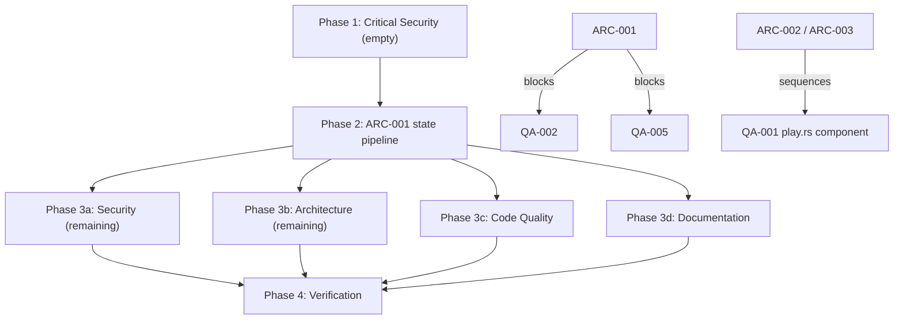

# Project Audit Report

> **Project**: hex-world
> **Date**: 2026-10-16
> **Stack**: Rust workspace → WASM (Bevy 0.20 pinned, `default-features = false`, WebGPU) · TypeScript HUD overlay (`web/ui`, esbuild) · Trunk v0.21.14 · GitHub Pages · Playwright e2e (local GPU only) · Blender asset pipeline
> **Audited by**: Claude Code Audit System
> **Board**: every finding is filed on kanban project `hex-world` tagged `audit-2026-10-16`; `/fix-audit` selects by that tag.

---

## Executive Summary

Hex World is in good engineering health: no Critical findings in any of the four domains. The highest-severity item is **SEC-001** — `ruzstd` 0.8.3 (RUSTSEC-2026-0344, high) ships in the player-facing wasm through `bevy_image` and is fixed by a one-line lockfile bump. The most consequential structural finding is **ARC-001**: the engine republishes the entire game state as JSON every frame with no change detection (serialize → parse → re-serialize → clone across the wasm boundary → JS re-parse, all O(world size) at 60 Hz). That is the root cause behind the tracked "Large play worlds are slow on the web" card and will tax every future feature until publication becomes change-driven. Estimated effort for the top issues: SEC-001 is S; ARC-001 and the code-quality decompositions (QA-001, QA-003) are L each, sequenced Phase 2 → 3. A standing strength worth naming: the Rust↔TypeScript bridge contract, the save-format engineering, and the gate/CI parity are exemplary — the project's discipline lives where regressions would be most expensive.

Methodology note: parsight's semantic embedding stage was mid-rebuild during Phase 1, so hub/hotspot analytics relied on structural data plus direct reads; this is reflected in the Audit Confidence table.

### Issue Count by Severity

| Severity | Architecture | Security | Code Quality | Documentation | Total |
|----------|:-----------:|:--------:|:------------:|:-------------:|:-----:|
| 🔴 Critical | 0 | 0 | 0 | 0 | **0** |
| 🟠 High     | 1 | 1 | 3 | 1 | **6** |
| 🟡 Medium   | 5 | 0 | 5 | 5 | **15** |
| 🔵 Low      | 3 | 3 | 1 | 4 | **11** |
| **Total**   | **9** | **4** | **9** | **10** | **32** |

Dedup note: the Code Quality agent's "per-frame state poll clones the full state JSON" (its QA-004) and Architecture's ARC-001 are the same defect — merged into ARC-001 (Architecture + Code Quality domains). Known, already-tracked items were referenced, not re-filed: the npm Dependabot card (sharp/braces in `scripts/assets/`), the PRD-drift card, the large-world perf card (updated with the ARC-001 root cause), and the thumbs/web-smoke flake cards.

---

## 🔴 Critical Issues (Resolve Immediately)

None found in any domain.

---

## 🟠 High Priority Issues

### [SEC-001] Decompression-bomb-vulnerable `ruzstd` 0.8.3 in the shipped runtime dependency tree
- **Area**: Security (CWE-409 / OWASP A06)
- **Location**: `Cargo.lock` (ruzstd 0.8.3, pulled by `bevy_image 0.20.0`)
- **Description**: `cargo audit` reports RUSTSEC-2026-0344 (severity 7.5, published 2026-10-11): a tiny zstd-compressed input can exhaust memory during decompression in ruzstd ≤ 0.8.x; fixed in 0.9.1. bevy_image uses ruzstd for KTX2 zstd-supercompressed textures, so the path is compiled into the player-facing wasm. Distinct from the known npm Dependabot card — this is Cargo-side.
- **Impact**: An attacker who can control compressed asset bytes (CDN compromise, future third-party content) OOMs the tab. Today all inputs are same-origin first-party assets, hence High, not Critical.
- **Remedy**: `cargo update -p ruzstd` to ≥ 0.9.1 (add an explicit `ruzstd = "0.9.1"` dep if bevy_image's range resists), re-run `make checkall`. While there: `ttf-parser 0.25.1` is flagged unmaintained (warning-level, transitive via Bevy text).

### [ARC-001] Per-frame full-state JSON serialization with no change detection *(Architecture + Code Quality)*
- **Area**: Architecture (root cause), Code Quality (bridge lever)
- **Location**: `crates/hex-app/src/control.rs:611-735` (`publish_state`), `crates/hex-app/src/bridge.rs:69-72` (`hex_world_state_json`), `web/ui/src/main.ts:133-156` (`tick`)
- **Description**: `publish_state` runs unconditionally every frame in the Update chain. In the play scenario it builds the entire game state as a `serde_json::Value` (every tile, car, ghost, rise, scatter entry), then `to_string()` into `STATE_JSON: Mutex<String>`. Sub-reports (`boids`, `scatter`, `grass`, `ghost`) are already JSON strings and are re-parsed with `from_str` inside `publish_state` only to be re-serialized. On the web, `hex_world_state_json` clones the whole String across the wasm boundary on every poll, and the UI's rAF loop parses it every frame. The throttle pattern already exists in-repo (`publish_diag` runs every 30 frames) but `publish_state` has no gate at all.
- **Impact**: A 2,000-tile world pays serialize → parse → serialize → clone → JS-parse, all O(world size) on the main thread, 60 times a second. This is the architectural root of the tracked "Large play worlds are slow on the web: 2,066-tile play world p95 55 ms" card, and every new subsystem adds another report into the same per-frame blob.
- **Remedy**: Gate publication on change detection (dirty flag set by mutating systems, or `Res::is_changed`), or move to pull-with-version (UI asks; engine re-serializes only when a version counter moved). Store sub-reports as `Value`/typed structs to kill the parse-re-serialize round trip; hand the buffer across the boundary via swap-and-take instead of clone.

### [QA-001] Complexity concentrated in monolithic dispatcher functions
- **Area**: Code Quality
- **Location**: `crates/hex-app/src/args.rs:109` (`flags_from_pairs_or`, cyclomatic 70), `crates/hex-app/src/game.rs:349` (`apply_inner`, 57, recursively re-dispatches), `web/ui/src/hud.ts:858` (`onKey`, 55, five ownership regimes), `crates/hex-app/src/control.rs:297` (`run_commands`, 48), `crates/hex-assets/src/meshopt_glb.rs:53` (`rewrite_glb`, 48), `crates/hex-render/src/play.rs:797` (`sync`, 40, spans 281 lines)
- **Description**: Nine functions rate critical-risk complexity. `flags_from_pairs_or` is a ~40-arm key/value match; `apply_inner` is one match over the whole `Action` enum that recursively re-dispatches into itself (`ToggleWalk` → `SetWalk`, `SelectNth` → `SelectTile`, `QuickPlace` → `Primary`); `onKey` layers rebuild/typing/settings/photo/walk guards before the main switch.
- **Impact**: Each new flag, action, command, or keybinding edits one of these monoliths; the regression surface per change is the whole function. Consistent with the change friction behind the known "PRD drift: six code deviations" card.
- **Remedy**: Handler table for `flags_from_pairs_or`; per-action extracted handlers for `apply_inner`; named mode-guard predicates for `onKey`; the play.rs `sync` split lands naturally with ARC-002/ARC-003.

### [QA-002] `run_commands` dispatches one command through three layers in a 16-parameter system
- **Area**: Code Quality
- **Location**: `crates/hex-app/src/control.rs:297`
- **Description**: `Command::Photo` and `Command::Walk` are special-cased before the match, `cmd.action()` early-returns into the action queue, and only then does the match handle the rest. The system takes ~16 `ResMut`/`Query` params.
- **Impact**: Handling for one command can live in up to three places; the parameter list grows with every feature needing a write handle.
- **Remedy**: Fold the pre-match special cases into the main match arms; bundle parameters into `#[derive(SystemParam)]` structs (photo group, persist group, walk/debug group). Sequence after ARC-001 (same files).

### [QA-003] `web/ui/src/hud.ts` is a ~1,000-line God module for the UI layer
- **Area**: Code Quality
- **Location**: `web/ui/src/hud.ts` (≥986 lines)
- **Description**: One class owns keyboard routing, toasts, tooltips, focus cycling, sheet/inventory, photo/walk/worlds/settings coordination, and placement tags.
- **Impact**: Highest-churn UI file; every feature lands in it and `onKey` must know about all of them.
- **Remedy**: Extract mode controllers (photo, walk, sheet) into modules with their own key handling, leaving the HUD a shell that delegates — the existing `this.photo.key(e)` / `this.settings.holds(target)` seams point the way. Coordinate with the blocked "P2 UI: hero-polish overlay" card to avoid splitting the file along two different seams concurrently.

### [DOC-001] No human-facing setup/bootstrap documentation
- **Area**: Documentation
- **Location**: `README.md` (missing section)
- **Description**: The README (24 lines) has description, play link, status, and pointers — no prerequisites or installation. The actual toolchain (Rust stable + `wasm32-unknown-unknown`, Trunk v0.21.14, Node 22.18+/24 type stripping, npm, uv + Pillow 12.2.0, ffmpeg with libopus, ImageMagick, python3, Blender 5.2, KTX-Software 4.4.2 via `make fetch-tools`, resvg 0.48.1) exists only in Makefile comments and scattered prose. The repo is public, MIT-licensed, with a live deployed game.
- **Impact**: A human contributor or curious player cannot build or run the project without reverse-engineering the Makefile and CI. Only agents that read everything succeed.
- **Remedy**: Add Prerequisites and Getting Started to README.md (or `docs/setup.md` linked from it): tool list with versions, `rustup target add wasm32-unknown-unknown`, `trunk serve` flow, `make checkall`.

---

## 🟡 Medium Priority Issues

### Architecture

- **[ARC-002] hex-render is a 27,462-line monolith (68% of the workspace's 45.5K Rust lines) with mixed concerns** — `crates/hex-render/src/` (water/tiles.rs 2,342; boids/plan.rs 2,145; play/scatter.rs 1,877; walk.rs 1,498; play/rise.rs 1,484; 20+ more files over 600 lines). One crate mixes engine gate/benchmark tooling, gameplay presentation (play/*), sim-adjacent rendering, and graphics infrastructure. Compile times, review surface, and merge conflicts concentrate; the "all Bevy render plugins" charter has quietly become "most of the game." Remedy: split along existing seams — extract `play/*` into a `hex-play` crate (already documented as rules-free), move gate/lookdev tooling behind a feature or dev crate; near term, hold the line on water/tiles.rs and boids/plan.rs.
- **[ARC-003] `HexRenderPlugin::build` registers the play subsystem's internals directly** — `crates/hex-render/src/lib.rs:187-228` `init_resource`s 14 play resources and hand-chains 12 play systems; each new play feature edits `lib.rs`. Open/closed violation at the composition point. Remedy: per-sub-feature `Plugin`s (as boids, cars, grass_gpu already have); `HexRenderPlugin` composes, not enumerates.
- **[ARC-004] Inconsistent modularization in hex-app** — `crates/hex-app/src/main.rs:104-172`: `sim` and `walk` are proper plugins; `photo`, `photo_fx`, `persist`, `actions`, `control` are bare resources + system functions whose 15 init calls and 17-system chained tuple live in main.rs, with ordering semantics implicit in tuple position. Remedy: wrap in plugins with named system sets (`CommandsSet`, `ApplySet`, `PublishSet`) and explicit before/after.
- **[ARC-005] Makefile DRY violation: ~15 near-identical checkpoint-shot recipes, and no `clean` target** — `Makefile:354-702`, ~300 lines of copy-paste with per-target drift already visible (some `caffeinate`, some black-frame checks, some neither — the drift silently produces flaky evidence). Remedy: a `define checkpoint-shots` macro or `scripts/shots/run.sh`; add `clean` covering `dist/`, `target/kit-stage/`, stamps.
- **[ARC-006] `publish_state`'s 25-parameter signature, with the lint that would flag it disabled workspace-wide** — `crates/hex-app/src/control.rs:611-654`; `Cargo.toml:14-16` (`too_many_arguments = "allow"`, `type_complexity = "allow"`). No aggregate app-state read model; the allowances suppress the signal everywhere. Remedy: group volatile published state into cohesive snapshot resources (game, agents, presentation, capture); scope the allows per-crate or per-system.

### Code Quality

- **[QA-005] Mutex-poisoning unwraps on every wasm export and in the command pump** — `crates/hex-app/src/bridge.rs:70-120`, `crates/hex-app/src/control.rs:322` (`INBOX`/`READY`). Moot on wasm (panic aborts the isolate); on native a panic while holding one of these locks turns every later frame into a panic loop. Remedy: `lock().unwrap_or_else(|p| p.into_inner())` for infallible shared state, or document the abort-on-panic contract at the statics.
- **[QA-006] Exact-duplicate `specialize` implementation across two post-effect pipelines** — `crates/hex-render/src/photo_fx.rs:217` and `tilt_shift.rs:327`, byte-identical 15 lines. A bind-group layout fix silently misses the other. Remedy: hoist into a shared helper.
- **[QA-007] Dead-code candidate `TileCatalog::kit_refs`** — `crates/hex-core/src/catalog.rs:168` (and `TileDef::kit_refs` at `tile.rs:334`): zero callers confirmed structurally; `pub` so rustc's dead-code lint cannot catch it. Remedy: manual verify, then remove. Do NOT act on the other flagged no-caller functions blindly — `publish_rise_events` and `plan_boids` are Bevy systems registered via `add_systems` (analyzer false positives).
- **[QA-008] `plan_boids` suppresses the long-parameter-list lint** — `crates/hex-render/src/boids.rs:714` carries `#[allow(clippy::too_many_arguments)]` for a 12+ param system; the allow acknowledges the smell rather than fixing it. Remedy: `SystemParam` bundles, then drop the allow.
- **[QA-009] `Persistence` class accumulating UI-facing responsibilities** — `web/ui/src/persist.ts:135` (≥624 lines): cohesive around saves but also owns toasts, world naming, export actions, slot summaries. Remedy: keep the save state machine; move notification/export UX behind a narrower host interface.

### Documentation

- **[DOC-002] No CONTRIBUTING.md / contribution workflow doc** — the workflow (worktree discipline, `make ui-schema` after Rust enum changes, `make checkall-ci` before push, checkpoint evidence) is split between CLAUDE.md and handoff.md, both agent-session docs. Nothing addresses an outside human. Remedy: short CONTRIBUTING.md mirroring the commands and gates.
- **[DOC-003] Rustdoc gaps on public crate APIs** — hex-core sample found 40+ public symbols with no doc comment (`Axial::neighbor/distance`, `ring_capacity`, `CatalogError`, `TileCatalog::get/sockets`, `SocketTable` methods, `Biome`, `AgentKind`, `PlaceError`/`BulldozeError`/`ReplaceError`, `World::bulldoze/can_undo/can_redo`, …). Remedy: prioritize `World` methods and the error enums.
- **[DOC-004] Out-of-repo reference links in committed docs of a public repo** — vault/memory wikilinks in `.claude/skills/blender-asset/references/gates.md:36`, `pitfalls.md:6,30`, `handoff.md:16,19`, and `docs/superpowers/research/2026-10-13-p1-asset-pipeline-brief.md` resolve to nothing outside this machine. Remedy: mark as external vault notes or inline the one-line lesson.
- **[DOC-005] No changelog or release-notes file** — history is tracked functionally (save-format version table, PRD §15 checkboxes, content-hash build ids) but there is no CHANGELOG.md and players see build ids, not versions. Remedy: minimal CHANGELOG.md per phase merge, or state the git-log-plus-PRD discipline in the README.
- **[DOC-006] Environment-variable reference is scattered** — 20+ tunables (`HEXW_UPDATE_SCHEMA`, `HEXW_FORCE_FAIL`, `HEXW_PACK_HOLD_FRAMES`, `PERF_LOAD_LIMIT`, `MATRIX_*`, `WW_*`, `GRASS_*`, `PASSES_*`, `WATER_TIERS`, output dirs, …) documented only where used. Remedy: a name/applies-to/default/effect table in docs/agent-operability.md.

---

## 🔵 Low Priority / Improvements

### Architecture

- **[ARC-007] Mixed dependency pinning policy and an unguarded Bevy/wgpu version pairing** — critical deps exact-pinned, rest caret-floating (Cargo.lock committed, so reproducible); the exposure is hex-render's direct `wgpu` dep, which must equal Bevy's internal wgpu on every upgrade — documented only by a comment. Remedy: a CI/typecheck-adjacent assertion that `cargo tree -i wgpu` shows exactly one version.
- **[ARC-008] hex-app/persist.rs bundles four concerns in 1,367 lines** — settings model, camera pose codec, save/load orchestration, web autosave queue. Layering is correct; split settings from flow when next touched.
- **[ARC-009] web/ui declares no `engines` field** — Node 22.18+ type-stripping constraint lives only in a Makefile comment. Add `engines: { "node": ">=22.18" }` or a `.node-version`.

### Security

- **[SEC-002] CSP allows `unsafe-inline` scripts and omits `base-uri`** — `index.html` meta CSP. No XSS sink exists today (verified), so defense-in-depth. Remedy: SHA-256 hashes for the three inline scripts; add `base-uri 'none'; form-action 'none'`; explicit `object-src 'none'`.
- **[SEC-003] CI installs Trunk from a GitHub release tarball without checksum verification** — `.github/workflows/ci.yml` web job: version-pinned over TLS, but piped into `sudo tar` with no digest check; the one unpinned supply-chain link (all Actions are SHA-pinned). Remedy: record the release SHA-256 and verify before extracting, or a SHA-pinned action.
- **[SEC-004] Hostile `.hexworld` file can at worst hang the importer's own tab** — `crates/hex-core/src/save.rs` `validate_history` replays every action; a maximal crafted history burns CPU in one blocked main-thread call. Memory bounded (16 MiB cap), everything validated, no cross-origin impact. Remedy: accept and document as threat-model scope, or cap replayed history (e.g. 10k actions) with a typed refusal.

### Code Quality

- **[QA-010] Duplicated helpers across Blender kit-piece generators** — `scripts/blender/kit/mat_*.py` share byte-identical `ramp`/`math` helpers (7 copies each); `_spruce.py`/`tree_forest.py` share `island_texels`. Likely deliberate self-containment per the blender-asset pipeline; a `_shared.py` would stop 7-way fix propagation. Possible overlap with the "Kit pipeline hygiene follow-ups" card.

### Documentation

- **[DOC-007] Stale path in frozen research brief** — `docs/superpowers/research/2026-10-13-p1-asset-pipeline-brief.md:46` cites `crates/hex-assets/tests/kit_gate.rs`; the gate lives at `crates/hex-render/tests/kit_gate.rs` (verified via the `kit-check` target). One-line fix or archive marker.
- **[DOC-008] Built-site paths used as source references** — `docs/agent-operability.md:148,365`, `docs/perf/stall-tail/README.md:63` use `web/ui/hud.js`/`hud.css` (deployed paths) without naming `web/ui/src` at first mention.
- **[DOC-009] README has no badges or license statement** — LICENSE (MIT) exists; the README never states it. Add a License line and the CI badge.
- **[DOC-010] No docs/DOCUMENTATION_STYLE_GUIDE.md** — strong de-facto conventions (dated decision docs, status headers, as-built language, tables over prose) but nothing written. Capture them.

Referenced (already tracked, not re-filed): **PRD freshness lag** — the "PRD drift: six code deviations" card enumerates the known deviations; **Dependabot npm alerts** — sharp 0.34.4 + transitive braces in `scripts/assets/package.json`, dev-machine only, never in the shipped bundle.

---

## Detailed Findings

### Architecture & Design

**Critical:** none — the layering is acyclic, the domain core is engine-free and testable, and the cross-language contract is enforced by tests.

**High:** ARC-001 (above). The codebase already knows the throttle pattern (`publish_diag` at main.rs:247 runs every 30 frames); `publish_state` has no `run_if`/`is_changed` gate at all.

**Medium:** ARC-002 through ARC-006 (above).

**Low:** ARC-007 through ARC-009 (above).

**Positive highlights:** crate layering clean and enforced by construction (hex-core zero engine deps, hex-sim no external deps, hex-assets Bevy behind a feature flag, hex-render's play module documented and honoring "no game rules"); bridge contract exemplary (typed enums, compile-time-exhaustive sample tables, `make ui-schema` regeneration with a staleness test, rules.ts parity-tested against hex-core for four scripted worlds); gate/CI parity disciplined (checkall/checkall-ci map job-for-job onto ci.yml, SHA-pinned actions, least-privilege permissions, executable size budgets); command pattern end-to-end with undo/redo as inverse-action history inside the versioned save; data-driven content with validator teeth (RON validated per (tile, rotation) with thumbnail coverage, kit provenance gates).

### Security Assessment

Scope: all 5 crates, wasm bridge, save decode path, web UI overlay, IndexedDB layer, dev servers, Node scripts, CI workflow, Cargo.lock (cargo audit, 581 crates), npm manifests, Dependabot via `gh api`.

**Critical:** none. **High:** SEC-001 (above). **Medium:** none. **Low:** SEC-002/003/004 (above).

The known npm Dependabot card is confirmed in scope and NOT re-filed: 4 open alerts — `sharp` 0.34.4 in `scripts/assets/package.json` against three vulnerable ranges plus transitive `braces` ≤3.0.3 (CVE-2026-93687); both live only in the asset-pipeline toolchain, never in the shipped bundle.

**Positive highlights:** save decode is exemplary untrusted-input handling (16 MiB cap first, magic/version/length/CRC in contract order, `decode_exact` rejects trailing bytes, non-finite floats rejected, q/r range validated before neighbor arithmetic, tile ids checked against catalog, full history replay-validated, all failures typed — no panics or unwraps on the decode path); zero `unsafe` blocks across all crates; no XSS sinks in the shipped UI (DOM built via createElement/setAttribute/text nodes; world names render as text nodes, whitespace-normalized and length-clamped); bridge surface narrow and typed (commands serde-parsed into a closed enum; native `path` fields inert on wasm — verified); CI hygiene (pull_request not pull_request_target, SHA-pinned actions, `permissions: contents: read`, deploy gated to main); dev servers bind loopback only; URL params validated and clamped; no secrets or key/token strings tracked; audio/asset URLs same-origin with content-hash versioning and `connect-src 'self'`.

### Code Quality Review

Evidence base: complexity, dead-code, and exact-duplicate analytics plus direct reads of bridge.rs, game.rs, control.rs, args.rs, save.rs, boids.rs, hud.ts, persist.ts, slots.ts. The parsight lexical/hotspot lanes were unavailable this pass; zero debt markers appeared in every sampled region.

**Critical:** none in the sampled core paths — save decoding, the wasm command bridge, and IndexedDB persistence are defensive, typed, and tested against corrupt input.

**High:** QA-001, QA-002, QA-003 (above). **Medium:** QA-005 through QA-009 (above; QA-004 merged into ARC-001). **Low:** QA-010 (above). No-action notes: `command_tag` (complexity 35) is a test-only exhaustive match that deliberately fails compilation when a command lacks a sample — correct pattern; `renderTag` (31) shrinks as a side effect of the hud split.

**Technical debt:** disabled lint rules at 3 locations (one unjustified — QA-008; two justified `cfg_attr` dead-code allows in bridge.rs). Files >500 lines: 16 files led by boids/plan.rs (≥1337), boids.rs (≥1183), save.rs (≥1176), play.rs (≥1078), instanced.rs (≥1037), water.rs (≥1006), hud.ts (≥986).

**Test coverage:** Moderate to Good (est. 50-70% of logic-bearing code). Strongest: data and protocol layers (save fixtures for every historical version, corrupt-payload tests, socket rules, bridge-schema contract, RON data validator, meshopt reimport gate). Untested: GPU render systems (covered only by local e2e and kit gates), HUD DOM interaction beyond rules tests, wasm export behavior outside smoke e2e.

**Positive highlights:** save-format engineering exemplary; bridge and command pump degrade gracefully (parse failures return false with console errors, bad commands logged and skipped, corrupt meshopt payloads tested to error); IndexedDB persistence defensive (handles no-IDB/blocked/errored/timed-out opens, type-guarded reads via `isMeta`, explicit commits on page hide); cross-language contract discipline (exhaustive `command_tag` sample test); layering respected with constraint-stating comments.

### Documentation Review

Scope note: read-only; parsight structural doc-link data used; the two reported "broken anchor" hits for `#new-version-available` were verified false positives (explicit `<a id>` at agent-operability.md:377).

**Critical:** none — agent onboarding (the primary audience) is fully served by CLAUDE.md, handoff.md, and docs/agent-operability.md, all current and accurate.

**High:** DOC-001 (above). **Medium:** DOC-002 through DOC-006 (above). **Low:** DOC-007 through DOC-010 (above), plus the referenced (already tracked) PRD freshness lag.

**Inventory:** README present-fair; API docs excellent (agent bridge surface); architecture docs good; changelog missing (functionally covered); contributing missing; deployment/ops partial (CI self-documenting); docstring coverage moderate (hex-app/args.rs and bridge.ts strong; hex-core public APIs largely undocumented, offset by prose docs).

**Positive highlights:** docs/agent-operability.md is an exceptionally thorough single-file interface reference (503 lines) and every sampled claim checked out (~35 documented CLI flags exist in args.rs, the hexWorld method table matches index.html, documented make targets match the Makefile); docs/save-format.md is a model format contract (byte-level layout, version table with dates and fixtures, ordered error taxonomy matching decode order, five-step migration recipe); the doc corpus is densely cross-referenced (109 live doc-to-doc edges) with explicit freshness discipline; ADRs record measurements and honest failures; bridge.ts carries precise JSDoc on every exported type; DESIGN.md is a token-level design system.

---

## Remediation Roadmap

### Immediate Actions (Before Next Deployment)
1. SEC-001 — `cargo update -p ruzstd` to ≥ 0.9.1, re-run `make checkall` (S).
2. ARC-001 — change-gated state publication (dirty flag or version counter; typed sub-reports; swap-and-take handoff). Start now; it unblocks the tracked large-world perf card (L).

### Short-term (Next 1–2 Sprints)
1. QA-002 and QA-005 after ARC-001 lands (same files).
2. SEC-002 (CSP hashes) and SEC-003 (Trunk checksum).
3. DOC-001 (setup docs), DOC-002 (CONTRIBUTING), DOC-004 (vault links), DOC-006 (env-var table).
4. QA-006 (duplicate specialize), QA-007 (kit_refs), QA-008 (SystemParam bundles).
5. ARC-006 (snapshot resources, scoped clippy allows).

### Long-term (Backlog)
1. ARC-002/ARC-003/ARC-004 crate and plugin restructures.
2. QA-001 and QA-003 dispatcher/module decompositions.
3. DOC-003 (hex-core rustdoc), ARC-005 (Makefile DRY + clean), QA-009/QA-010.
4. ARC-007/008/009 and DOC-005/007/008/009/010.

---

## Positive Highlights

1. **Crate layering is clean, acyclic, and enforced by construction** — hex-core has zero engine dependencies, hex-sim depends only on hex-core with no external deps, hex-assets hides Bevy behind a feature flag, and hex-render's play module documents and honors "no game rules."
2. **The Rust↔TypeScript bridge contract is exemplary** — typed enums, compile-time-exhaustive sample tables, schema regeneration with a staleness test, and TS rules parity-tested against hex-core's own answers.
3. **Save-format engineering is exemplary** — 16 MiB cap, contract-ordered checks, typed errors, one-arm-per-version migrations, fixtures for every historical version; the decode path is a model of untrusted-input handling.
4. **Gate/CI parity is disciplined** — checkall/checkall-ci map job-for-job onto CI; SHA-pinned actions; least-privilege permissions; size budgets are executable targets.
5. **Zero `unsafe` and no XSS sinks** — DOM built via createElement/text nodes; save-derived strings clamped and normalized before rendering.
6. **Data-driven content with validator teeth** — RON tiles/sockets validated per (tile, rotation) with thumbnail coverage; kit provenance gates.
7. **docs/agent-operability.md and docs/save-format.md** — thorough, verified-accurate interface and format references.
8. **Defensive persistence** — IndexedDB opens handle every failure mode; reads type-guarded; writes commit on page hide.

---

## Audit Confidence

| Area | Files Reviewed | Confidence |
|------|---------------|-----------|
| Architecture | ~16 (composition roots, manifests, build files, cited modules) | Medium — parsight hub analytics mid-embed; direct reads authoritative |
| Security | ~25 + Cargo.lock (cargo audit, 581 crates) + CI + npm manifests + Dependabot via gh | High |
| Code Quality | ~18 core files + complexity/dead-code/exact-duplicate analytics | Medium — lexical/hotspot lanes unavailable during index rebuild |
| Documentation | ~22 doc and source files + structural link map | High |

*Low confidence areas may benefit from a targeted manual review. The parsight embedding stage completed after Phase 1 launched; a future audit will have full semantic/hotspot analytics.*

---

## Remediation Plan

> This section is generated by the audit and consumed directly by `/fix-audit`.
> It pre-computes phase assignments and file conflicts so the fix orchestrator
> can proceed without re-analyzing the codebase.

### Phase Assignments

#### Phase 1 — Critical Security (Sequential, Blocking)

No Critical Security issues. No Security issue modifies a conflict file also targeted by Code Quality (SEC files: Cargo.lock, index.html, .github/workflows/ci.yml, save.rs documentation), so nothing is promoted here.

#### Phase 2 — Critical Architecture (Sequential, Blocking)

| ID | Title | File(s) | Severity | Blocks |
|----|-------|---------|----------|--------|
| ARC-001 | Per-frame full-state JSON serialization with no change detection (maps to board card 01a14028862a70ed87a30b165241fcec, the large-world perf card) | `crates/hex-app/src/control.rs`, `crates/hex-app/src/bridge.rs`, `web/ui/src/main.ts` | High (promoted: explicitly blocks QA-002, QA-005) | QA-002, QA-005, QA-001 (control.rs component) |

#### Phase 3 — Parallel Execution

**3a — Security (remaining)**
| ID | Title | File(s) | Severity |
|----|-------|---------|----------|
| SEC-001 | Bump ruzstd to ≥ 0.9.1 (RUSTSEC-2026-0344) | `Cargo.lock` | High |
| SEC-002 | Harden CSP (hashes, base-uri) | `index.html` | Low |
| SEC-003 | Verify Trunk tarball checksum in CI | `.github/workflows/ci.yml` | Low |
| SEC-004 | Document accepted risk: hostile-save replay CPU | `docs/` (threat model note) | Low |

**3b — Architecture (remaining)**
| ID | Title | File(s) | Severity |
|----|-------|---------|----------|
| ARC-002 | Split hex-render along its seams | `crates/hex-render/src/` | Medium |
| ARC-003 | Per-feature play plugins | `crates/hex-render/src/lib.rs` | Medium |
| ARC-004 | hex-app plugins with named system sets | `crates/hex-app/src/main.rs` | Medium |
| ARC-005 | DRY checkpoint-shot recipes; add clean | `Makefile` | Medium |
| ARC-006 | Snapshot resources; scoped clippy allows | `crates/hex-app/src/control.rs`, `Cargo.toml` | Medium |
| ARC-007 | CI single-wgpu assertion | CI / typecheck step | Low |
| ARC-008 | Split persist.rs | `crates/hex-app/src/persist.rs` | Low |
| ARC-009 | Node engines field | `web/ui/package.json` | Low |

**3c — Code Quality (all)**
| ID | Title | File(s) | Severity |
|----|-------|---------|----------|
| QA-001 | Decompose monolithic dispatchers | `crates/hex-app/src/args.rs`, `crates/hex-app/src/game.rs`, `web/ui/src/hud.ts`, `crates/hex-app/src/control.rs`, `crates/hex-assets/src/meshopt_glb.rs`, `crates/hex-render/src/play.rs` | High |
| QA-002 | Fold run_commands special cases; SystemParam bundles | `crates/hex-app/src/control.rs` | High |
| QA-003 | Split hud.ts into mode controllers | `web/ui/src/hud.ts` | High |
| QA-005 | Poisoning-tolerant lock handling | `crates/hex-app/src/bridge.rs`, `crates/hex-app/src/control.rs` | Medium |
| QA-006 | Hoist duplicated specialize() | `crates/hex-render/src/photo_fx.rs`, `crates/hex-render/src/tilt_shift.rs` | Medium |
| QA-007 | Verify/remove dead kit_refs | `crates/hex-core/src/catalog.rs`, `crates/hex-core/src/tile.rs` | Medium |
| QA-008 | plan_boids SystemParam bundles | `crates/hex-render/src/boids.rs` | Medium |
| QA-009 | Narrow Persistence class | `web/ui/src/persist.ts` | Medium |
| QA-010 | Shared Blender kit helpers | `scripts/blender/kit/*.py` | Low |

**3d — Documentation (all)**
| ID | Title | File(s) | Severity |
|----|-------|---------|----------|
| DOC-001 | Human prerequisites/getting-started docs | `README.md` (or `docs/setup.md`) | High |
| DOC-002 | CONTRIBUTING.md | repo root | Medium |
| DOC-003 | Rustdoc hex-core public APIs | `crates/hex-core/src/` | Medium |
| DOC-004 | Replace private vault wikilinks | `handoff.md`, `.claude/skills/blender-asset/references/`, `docs/superpowers/research/` | Medium |
| DOC-005 | Changelog or stated discipline | repo root / `README.md` | Medium |
| DOC-006 | Env-var reference table | `docs/agent-operability.md` | Medium |
| DOC-007 | Fix stale kit_gate.rs path | `docs/superpowers/research/2026-10-13-p1-asset-pipeline-brief.md` | Low |
| DOC-008 | Built vs source path clarifications | `docs/agent-operability.md`, `docs/perf/stall-tail/README.md` | Low |
| DOC-009 | README license + CI badge | `README.md` | Low |
| DOC-010 | Documentation style guide | `docs/DOCUMENTATION_STYLE_GUIDE.md` | Low |

### File Conflict Map
<!-- Files touched by issues in multiple domains. Fix agents must read current file state
     before editing — a prior agent may have already changed these. -->

| File | Domains | Issues | Risk |
|------|---------|--------|------|
| `crates/hex-app/src/control.rs` | Architecture + Code Quality | ARC-001, ARC-006, QA-001, QA-002, QA-005 | ⚠️ Read before edit |
| `crates/hex-app/src/bridge.rs` | Architecture + Code Quality | ARC-001, QA-005 | ⚠️ Read before edit |

### Blocking Relationships
<!-- Explicit dependency declarations from audit agents.
     Format: [blocker issue] → [blocked issue] — reason -->
- ARC-001 → QA-002: ARC-001 reworks the publish/dispatch pipeline in control.rs that QA-002 also targets
- ARC-001 → QA-005: ARC-001 reworks bridge.rs/state handoff that QA-005's lock handling touches
- ARC-001 → QA-001 (partial): only the control.rs `run_commands` component; args.rs/game.rs/hud.ts components are independent
- ARC-002/ARC-003 → QA-001 (partial): restructure hex-render before decomposing play.rs `sync`, to avoid churn on moved code
- QA-003 → coordinate with the blocked "P2 UI: hero-polish overlay" card — do not split hud.ts along two different seams concurrently
- SEC-001 → any dependency upgrade touching Cargo.toml/Cargo.lock: land together to avoid lockfile churn conflicts
- DOC PRD §12/§14 accuracy work → after the existing "PRD drift: six code deviations" card (01a13d8883ea) lands

### Dependency Diagram

