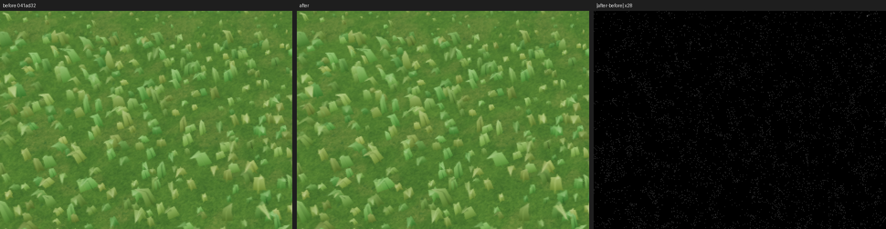
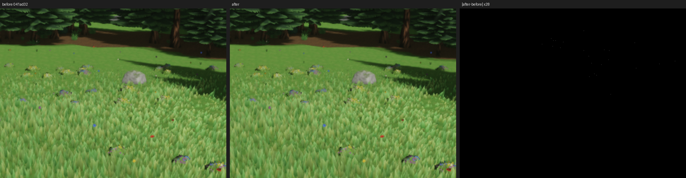

# Grass build rework: look check

The 2026-10-26 grass build rework (`docs/perf/grass-build/README.md`) keeps every blade bit for bit. The 90-build output digest is `922e04ec1819a73c` before and after. This page checks the drawn result with `make shots-grass`: the 16 PNGs of the before build (`041ad32`'s grass and scatter sources) and of the after build, captured on the dev host on 2026-10-26, a few minutes apart.

The shots are not byte-reproducible from run to run. Two runs of the same after build differ in 9 of the 16 shots. In the eye-level shots the difference is up to 2,755 pixels at up to 163 levels in the sky band (the birds). The `grass-06-eye-off` shot, which draws no grass at all, differs by about the same amount. The other run-to-run differences are 3 to 622 pixels.

| Shot | Before vs after: pixels, max level | After vs after (run to run) |
|---|---|---|
| grass-01-meadow | 247, 4 | 332, 1 |
| grass-02-forest | 0 | 0 |
| grass-03-road-verge | 36,975, 9 (36,405 of them at 1) | 0 |
| grass-04-river-bank | 10, 1 | 0 |
| grass-05-eye | 2,482, 163 | 2,483, 163 |
| grass-06-eye-off (no grass) | 2,713, 126 | 2,639, 126 |
| grass-07-midzoom | 636, 96 | 622, 96 |
| grass-08-gust-1 to -4 | 40 to 52, 1 | 31 to 41, 1 |
| grass-09-low | 0 | 3, 1 |
| grass-10-eye-lush | 2,372, 162 | 2,374, 162 |
| grass-10-eye-sparse | 2,749, 165 | 2,755, 165 |
| grass-11-border-meadow, grass-12-border-forest | 0 | 0 |

Only `grass-03-road-verge` differs beyond the run-to-run noise. In it, the grass of two tiles changes by one level per channel in scattered pixels, and by at most 9 levels in a few. The crop below shows before, after, and their difference scaled by 28. No difference is visible.

The cause is the new start rule for a frame's second and third tile. A control run used the new build with only the old start rule restored. Its `grass-03-road-verge` and `grass-04-river-bank` match the before PNGs byte for byte (`grass-01-meadow` differs, within its run-to-run noise). The blades are identical, but a tile's group can now appear a frame later, so the TAA history at the capture frame differs by a level.
